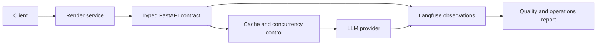
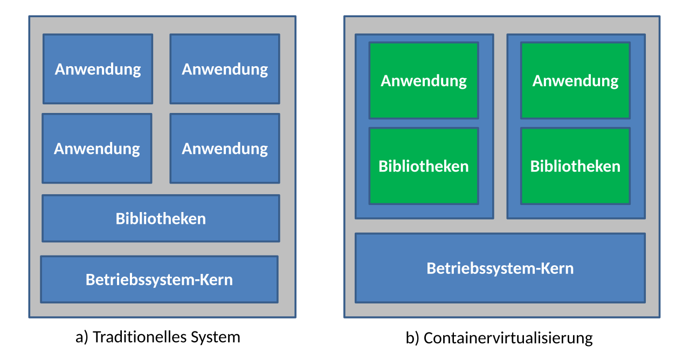

# LLM Application Deployment Project

Please **use this repository as a template** for your final deployment project.
Deploy a production-shaped Northstar support assistant with a typed inference
API, a reproducible container, resilient caching, and observability for service
health and LLM-specific behavior.

This assignment combines the preceding FastAPI, container deployment, and
Langfuse units. The default evaluation is deterministic and requires no API
keys; your deployed evidence should use a live provider when available and
record the resulting operational trade-offs.

## Learning Objectives

By completing this project, you should be able to:

- Build and deploy a complete LLM-powered application with an inference API,
  containerization, hosted deployment, caching, and production observability.
- Demonstrate and interpret both service-health metrics such as latency and
  errors and LLM-specific metrics such as token usage, cost, and answer quality.

## Learning Path

| Resource | Focus |
|---|---|
| [Project Brief](project-description.md) | Scenario, requirements, milestones, and deliverables. |
| [Evaluation Cases](data/evaluation/cases.json) | Shared functional and cache-evaluation cases. |
| [Load Profile](data/operations/load_profile.json) | Load profile and service objectives for the report. |
| [Reference Solution](solution/README.md) | Runnable scaffold to inspect after attempting the project. |

### Additional Folders and Files

| File / Folder | Description |
|---|---|
| [**pyproject.toml**](pyproject.toml) | Project configuration and dependencies. |
| [**uv.lock**](uv.lock) | Dependency lock file. |
| [**.env.example**](.env.example) | Default settings and credential placeholders. |
| [**Assets**](assets/README.md) | Visual sources and credits. |

## Required Workflow

1. Define typed health, readiness, and generation contracts.
2. Implement provider-backed generation with bounded concurrency and graceful
   upstream failure handling.
3. Add exact-match caching and prove that repeated requests avoid redundant
   provider usage.
4. Package the service in Docker and deploy it to Render with secrets and
   health checks configured outside the image.
5. Instrument request, retrieval or preparation, generation, cache, token,
   cost, latency, error, release, and quality signals.
6. Run the shared functional evaluation and load profile, then write a
   deployment report that decides whether the service meets its objectives.





*Source: [Containerization](https://commons.wikimedia.org/wiki/File:Containerization.svg), Wikimedia Commons; CC BY-SA 4.0 and GFDL, by MoreInput.*

## Deliverables

Your repository must include:

- a runnable typed inference API with `/health`, `/ready`, and `/generate`;
- a production Dockerfile and Render Blueprint with no committed secrets;
- a provider abstraction with deterministic tests and a documented live model;
- exact-match caching, concurrency bounds, timeouts, and upstream error mapping;
- Langfuse observations with nested stages, token usage, cost, release, and
  environment metadata;
- at least one automated or deterministic answer-quality score;
- tests for API validation, caching, errors, trace completeness, and evaluation;
- load evidence for throughput, p95 latency, and error rate; and
- `reports/deployment_report.md` comparing observed results with the supplied
  service objectives and listing prioritized improvements.

## Setup

Use [uv](https://docs.astral.sh/uv/getting-started/installation/) 0.13.5 or newer
and Python 3.13.17 or a newer 3.13 patch release, as defined in
[`.python-version`](.python-version).

Rebuild existing Docker images with `--pull --no-cache` after this update
to refresh their system certificates and dependencies.

> [!NOTE]
> Throughout these steps, text in angle brackets like `<repo-name>` is a **placeholder**. Replace it, including the `< >` brackets, with your own value. For example, `cd <repo-name>` becomes `cd mle-llm-application-deployment-project`.

### 1. Create the Repository from the Template

Click **Use this template** on GitHub.

When creating the repository:

- Set yourself as the **Owner**
- Choose a repository name
- Disable **Include all branches**
- Click **Create repository**

> [!IMPORTANT]
> If you are working in pairs or groups, only **one person** should complete this step.

---

### 2. Add Collaborators (Pairs/Groups Only)

If working with teammates:

1. Open the repository on GitHub
2. Go to **Settings → Collaborators**
3. Add your teammates as collaborators
4. Share the repository link with your team

Teammates should accept the invitation before continuing.

---

### 3. Clone the Repository

Copy the SSH URL from the **Code** button on GitHub, then run:

```bash
git clone <copied-ssh-url>
```

The copied SSH URL will look like `git@github.com:<your-username>/<repo-name>.git`.

---

### 4. Move into the Project Folder and Install Dependencies

The command below installs all dependencies and creates a virtual environment in `.venv/`.

```bash
cd <repo-name>
uv sync
```

Python 3.13 is selected by `.python-version`. Install [uv](https://docs.astral.sh/uv/getting-started/installation/) first if needed.

---

### 5. Set Up Environment Variables

```bash
cp .env.example .env
```

Keep the defaults for the first local run. Never commit `.env` or real credentials.

---

### 6. Open the Repository in VS Code

```bash
code .
```

Select the Python interpreter in `.venv/` and run commands from the repository root.

## Run Locally

```bash
uv run python -m solution.deployment_project inspect-data
uv run python -m solution.deployment_project evaluate
uv run pytest
```

These commands run the deterministic reference, not a live model. Try the project brief before inspecting the solution. Docker Desktop is required for the container exercise. For live calls, use `MODEL_PROVIDER=groq` (primary), `mistral` (alternative), `openrouter` or `google` (optional), with the matching key in `.env`. OpenRouter defaults to `google/gemma-4-26b-a4b-it:free`, with `openrouter/free` as a server-side backup configured by `OPENROUTER_FALLBACK_MODEL`. Responses identify the model actually used. Free accounts currently share [50 requests/day across free models](https://openrouter.ai/pricing). For optional direct [Gemma access](https://ai.google.dev/gemma/docs/core/gemma_on_gemini_api) through Google AI Studio, independent of OpenRouter, set `MODEL_PROVIDER=google`, `GOOGLE_API_KEY` and `GOOGLE_MODEL=gemma-4-26b-a4b-it`. Google free [rate limits](https://ai.google.dev/gemini-api/docs/rate-limits) vary by project and model; use only non-sensitive exercise data on the free tier. Render deployment and other live models can incur charges; credentials belong in `.env` or the hosting dashboard, never Git.

## Useful References

- [Render Docker deployment](https://render.com/docs/docker).
- [Render Blueprint specification](https://render.com/docs/blueprint-spec).
- [Langfuse observability](https://langfuse.com/docs/observability/overview).
- [Langfuse scores](https://langfuse.com/docs/evaluation/scores/overview).
- [FastAPI deployment concepts](https://fastapi.tiangolo.com/deployment/concepts/).
- [Groq OpenAI compatibility](https://console.groq.com/docs/openai).

## Mermaid Diagrams

This repository contains Mermaid diagrams. If you want them to render in VS Code, we recommend installing the `Markdown Preview Mermaid Support` extension:

- [Install in VS Code](vscode:extension/bierner.markdown-mermaid)
- [View on Marketplace](https://marketplace.visualstudio.com/items?itemName=bierner.markdown-mermaid)
