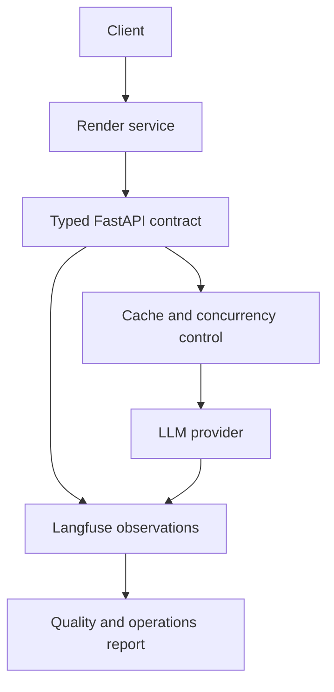

# LLM Application Deployment Project

Use this repository as a **template** for your final deployment project.
Deploy a production-shaped Northstar support assistant with a typed inference
API, a reproducible container, resilient caching, and observability for service
health and LLM-specific behavior.

This assignment combines the preceding FastAPI, container deployment, and
Langfuse units. Start with a local, repeatable baseline, then collect evidence
from the hosted service. The supplied dry-mode evaluation needs no API keys
and does not establish live inference quality or capacity.

## Learning Objectives

By the end of this repository, you should be able to:

- Build and deploy a complete LLM-powered application with an inference API,
  containerization, hosted deployment, caching, and production observability.
- Demonstrate and interpret both service-health metrics such as latency and
  errors and LLM-specific metrics such as token usage, cost, and answer quality.

## Learning Path



| File / Folder | Description |
|---|---|
| [**Project Description**](project-description.md) | Scenario, milestones, deliverables, and acceptance checklist. |

### Additional Folders and Files

| File / Folder | Description |
|---|---|
| [**data/evaluation**](data/evaluation/cases.json) | Shared functional and cache-evaluation cases. |
| [**data/operations**](data/operations/load_profile.json) | Load profile and service objectives for the report. |
| [**solution**](solution/README.md) | Runnable reference scaffold and tests. Inspect after attempting the project. |
| [**Assets**](assets/README.md) | Visual sources and credits. |
| [**.env.example**](.env.example) | Default settings and credential placeholders. |
| [**pyproject.toml**](pyproject.toml) | Project configuration and dependencies. |
| [**uv.lock**](uv.lock) | Dependency lock file. |

## Prerequisites

Start Docker Desktop or a compatible Docker Engine before the container
milestone. Use an approved Render setup for the hosted milestone. Hosted
resources and live model calls can incur charges.

> [!NOTE]
> **Windows Users:** The examples use Bash syntax. Run them in Git Bash.

## Setup

Use [uv](https://docs.astral.sh/uv/getting-started/installation/) 0.13.5 or newer
and Python 3.13.17 or a newer 3.13 patch release, as defined in
[`.python-version`](.python-version).

> [!NOTE]
> Throughout these steps, text in angle brackets like `<repo-name>` is a **placeholder**. Replace it, including the `< >` brackets, with your own value. For example, `cd <repo-name>` becomes `cd mle-llm-application-deployment-project`.

### 1. Create the Repository from the Template

Click **Use this template** on GitHub.

When creating the repository:

- Set yourself as the **Owner**
- Choose a repository name
- Disable **Include all branches**
- Click **Create repository**

> [!IMPORTANT]
> If you are working in pairs or groups, only **one person** should complete this step.

---

### 2. Add Collaborators (Pairs/Groups Only)

If working with teammates:

1. Open the repository on GitHub
2. Go to **Settings → Collaborators**
3. Add your teammates as collaborators
4. Share the repository link with your team

Teammates should accept the invitation before continuing.

---

### 3. Clone the Repository

Copy the SSH URL from the **Code** button on GitHub, then run:

```bash
git clone <copied-ssh-url>
```

The copied SSH URL will look like `git@github.com:<your-username>/<repo-name>.git`.

---

### 4. Move into the Project Folder and Install Dependencies

The command below installs all dependencies and creates a virtual environment in `.venv/`.

```bash
cd <repo-name>
uv sync --locked
```

---

### 5. Set Up Environment Variables

```bash
test -f .env || cp .env.example .env
```

Start with a stub and local trace output to check your own API. The supplied
reference uses `MODEL_PROVIDER=dry` and `TRACE_SINK=jsonl` for that path.
For a live run, use the matching provider, model and credentials from
[`.env.example`](.env.example).

> [!CAUTION]
> Never commit `.env` or real credentials.

---

### 6. Open the Repository in VS Code

```bash
code .
```

Select the Python interpreter in `.venv/` and run commands from the repository root.

## Required Deliverables

Read the [required implementation](project-description.md#required-implementation)
and agree on the API contract before choosing a provider. Then follow the
[three milestones](project-description.md#suggested-milestones) and use the
[acceptance checklist](project-description.md#minimum-acceptance-checklist)
before submitting.

Submit the tested inference API, Dockerfile and Render Blueprint,
cache and capacity controls, Langfuse observations and answer-quality
evaluation. In `reports/deployment_report.md`, compare functional and load
results with the supplied objectives and justify a deployment recommendation.

Keep the shared inputs, labels, and thresholds unchanged. To inspect the
load profile:

```bash
uv run --locked python -m json.tool data/operations/load_profile.json
```

Expect 40 requests at concurrency 5, with separate latency, error-rate, and
quality objectives. This only reads the workload definition; it does not
send requests or produce an evaluation result.

After attempting the project, use the [reference walkthrough](solution/README.md)
to compare your API and evaluation evidence. The reference is a scaffold,
not a completed submission.

## References & Further Reading

- Render: [Docker Deployment](https://render.com/docs/docker) / [Blueprint Specification](https://render.com/docs/blueprint-spec)
- Langfuse: [Observability](https://langfuse.com/docs/observability/overview) / [Scores](https://langfuse.com/docs/evaluation/scores/overview)
- [FastAPI Deployment Concepts](https://fastapi.tiangolo.com/deployment/concepts/)
