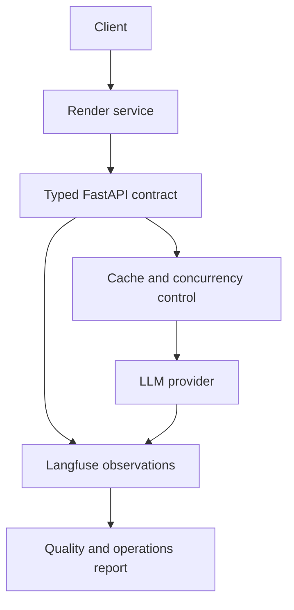

# LLM Application Deployment Project

Please **use this repository as a template** for your final deployment project.
Deploy a production-shaped Northstar support assistant with a typed inference
API, a reproducible container, resilient caching, and observability for service
health and LLM-specific behavior.

This assignment combines the preceding FastAPI, container deployment, and
Langfuse units. Start with a local, repeatable baseline, then collect evidence
from the hosted service. The supplied dry-mode evaluation needs no API keys
and does not establish live inference quality or capacity.

## Learning Objectives

By completing this project, you should be able to:

- Build and deploy a complete LLM-powered application with an inference API,
  containerization, hosted deployment, caching, and production observability.
- Demonstrate and interpret both service-health metrics such as latency and
  errors and LLM-specific metrics such as token usage, cost, and answer quality.

## Learning Path

| Resource | Focus |
|---|---|
| [Project Brief](project-description.md) | Scenario, requirements, milestones, and deliverables. |

### Additional Folders and Files

| File / Folder | Description |
|---|---|
| [**pyproject.toml**](pyproject.toml) | Project configuration and dependencies. |
| [**uv.lock**](uv.lock) | Dependency lock file. |
| [**.env.example**](.env.example) | Default settings and credential placeholders. |
| [**Evaluation Cases**](data/evaluation/cases.json) | Shared functional and cache-evaluation cases. |
| [**Load Profile**](data/operations/load_profile.json) | Load profile and service objectives for the report. |
| [**Reference Solution**](solution/README.md) | Optional runnable scaffold to inspect after attempting the project. |
| [**Assets**](assets/README.md) | Visual sources and credits. |

## Start The Project

1. Read the [required implementation](project-description.md#required-implementation)
   and agree on your API contract before choosing a provider.
2. Inspect the [shared cases](data/evaluation/cases.json) and
   [load profile](data/operations/load_profile.json). Keep their inputs,
   labels, and thresholds unchanged so reviewers can reproduce your results.
3. Follow the [three milestones](project-description.md#suggested-milestones).
   Each ends with a concrete check you can carry into the final report.




*Source: [Containerization](https://commons.wikimedia.org/wiki/File:Containerization.svg), Wikimedia Commons; CC BY-SA 4.0 and GFDL, by MoreInput.*

## Deliverables

Your repository must include:

- a runnable typed inference API with `/health`, `/ready`, and `/generate`;
- a production Dockerfile and Render Blueprint with no committed secrets;
- a provider abstraction with deterministic tests and a documented live model;
- exact-match caching, concurrency bounds, timeouts, and upstream error mapping;
- Langfuse observations with nested stages, token usage, cost, release, and
  environment metadata;
- at least one automated or deterministic answer-quality score;
- tests for API validation, caching, errors, trace completeness, and evaluation;
- load evidence for throughput, p95 latency, and error rate; and
- `reports/deployment_report.md` comparing observed results with the supplied
  service objectives and listing prioritized improvements.

## Setup

Use [uv](https://docs.astral.sh/uv/getting-started/installation/) 0.13.5 or newer
and Python 3.13.17 or a newer 3.13 patch release, as defined in
[`.python-version`](.python-version).

Rebuild existing Docker images with `--pull --no-cache` after this update
to refresh their system certificates and dependencies.

> [!NOTE]
> Throughout these steps, text in angle brackets like `<repo-name>` is a **placeholder**. Replace it, including the `< >` brackets, with your own value. For example, `cd <repo-name>` becomes `cd mle-llm-application-deployment-project`.

### 1. Create the Repository from the Template

Click **Use this template** on GitHub.

When creating the repository:

- Set yourself as the **Owner**
- Choose a repository name
- Disable **Include all branches**
- Click **Create repository**

> [!IMPORTANT]
> If you are working in pairs or groups, only **one person** should complete this step.

---

### 2. Add Collaborators (Pairs/Groups Only)

If working with teammates:

1. Open the repository on GitHub
2. Go to **Settings → Collaborators**
3. Add your teammates as collaborators
4. Share the repository link with your team

Teammates should accept the invitation before continuing.

---

### 3. Clone the Repository

Copy the SSH URL from the **Code** button on GitHub, then run:

```bash
git clone <copied-ssh-url>
```

The copied SSH URL will look like `git@github.com:<your-username>/<repo-name>.git`.

---

### 4. Move into the Project Folder and Install Dependencies

The command below installs all dependencies and creates a virtual environment in `.venv/`.

```bash
cd <repo-name>
uv sync --locked
```

Python 3.13 is selected by `.python-version`. Install [uv](https://docs.astral.sh/uv/getting-started/installation/) first if needed.

---

### 5. Set Up Environment Variables

```bash
test -f .env || cp .env.example .env
```

Start with a stub and local trace output to check your own API. The supplied
reference uses `MODEL_PROVIDER=dry` and `TRACE_SINK=jsonl` for that path.
For a live run, use the matching provider, model and credentials from
[`.env.example`](.env.example). Never commit `.env` or real credentials.

---

### 6. Open the Repository in VS Code

```bash
code .
```

Select the Python interpreter in `.venv/` and run commands from the repository root.

## Inspect The Provided Inputs

```bash
uv run --locked python -m json.tool data/operations/load_profile.json
```

Expect 40 requests at concurrency 5, with separate latency, error-rate, and
quality objectives. This only reads the workload definition; it does not
send requests or produce an evaluation result. Start Docker before the
container milestone. The examples use Bash syntax; on Windows, use Git Bash.

After attempting the project, use the [reference walkthrough](solution/README.md)
to compare your API and evaluation evidence. The reference is a scaffold,
not a completed submission. Hosted resources and live model calls can incur
charges; use an approved setup before deploying.

## Useful References

- [Render Docker deployment](https://render.com/docs/docker).
- [Render Blueprint specification](https://render.com/docs/blueprint-spec).
- [Langfuse observability](https://langfuse.com/docs/observability/overview).
- [Langfuse scores](https://langfuse.com/docs/evaluation/scores/overview).
- [FastAPI deployment concepts](https://fastapi.tiangolo.com/deployment/concepts/).
- [Groq OpenAI compatibility](https://console.groq.com/docs/openai).

## Mermaid Diagrams

This repository contains Mermaid diagrams. If you want them to render in VS Code, we recommend installing the `Markdown Preview Mermaid Support` extension:

- [Install in VS Code](vscode:extension/bierner.markdown-mermaid)
- [View on Marketplace](https://marketplace.visualstudio.com/items?itemName=bierner.markdown-mermaid)
