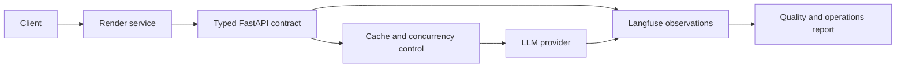

# LLM Application Deployment Project

Please **use this repository as a template** for your final deployment project.
Deploy a production-shaped Northstar support assistant with a typed inference
API, a reproducible container, resilient caching, and observability for service
health and LLM-specific behavior.

This assignment combines the preceding FastAPI, container deployment, and
Langfuse units. The default evaluation is deterministic and requires no API
keys; your deployed evidence should use a live provider when available and
record the resulting operational trade-offs.

## Project Hub

- [project-description.md](project-description.md): Scenario, requirements,
  milestones, deliverables, and acceptance checklist.
- [data/evaluation/cases.json](data/evaluation/cases.json): Shared functional
  and cache-evaluation cases.
- [data/operations/load_profile.json](data/operations/load_profile.json): Load
  profile and service objectives used in the deployment report.
- [solution/README.md](solution/README.md): Separate runnable reference
  implementation to inspect after attempting the project.
- [assets/README.md](assets/README.md): visual assets and source credits.

## Required Workflow

1. Define typed health, readiness, and generation contracts.
2. Implement provider-backed generation with bounded concurrency and graceful
   upstream failure handling.
3. Add exact-match caching and prove that repeated requests avoid redundant
   provider usage.
4. Package the service in Docker and deploy it to Render with secrets and
   health checks configured outside the image.
5. Instrument request, retrieval or preparation, generation, cache, token,
   cost, latency, error, release, and quality signals.
6. Run the shared functional evaluation and load profile, then write a
   deployment report that decides whether the service meets its objectives.




*Source: [Containerization](https://commons.wikimedia.org/wiki/File:Containerization.svg), Wikimedia Commons; CC BY-SA 4.0 and GFDL, by MoreInput.*

## Deliverables

Your repository must include:

- a runnable typed inference API with `/health`, `/ready`, and `/generate`;
- a production Dockerfile and Render Blueprint with no committed secrets;
- a provider abstraction with deterministic tests and a documented live model;
- exact-match caching, concurrency bounds, timeouts, and upstream error mapping;
- Langfuse observations with nested stages, token usage, cost, release, and
  environment metadata;
- at least one automated or deterministic answer-quality score;
- tests for API validation, caching, errors, trace completeness, and evaluation;
- load evidence for throughput, p95 latency, and error rate; and
- `reports/deployment_report.md` comparing observed results with the supplied
  service objectives and listing prioritized improvements.

## Environment

```bash
uv sync
cp .env.example .env
uv run python -m solution.deployment_project inspect-data
uv run python -m solution.deployment_project evaluate
uv run pytest
```

The commands above use deterministic dry mode. Live provider and Langfuse
credentials belong only in `.env` locally and in Render's secret configuration
for deployment.

## Learning Objectives

By completing this project, you should be able to:

- Build and deploy a complete LLM-powered application with an inference API,
  containerization, hosted deployment, caching, and production observability.
- Demonstrate and interpret both service-health metrics such as latency and
  errors and LLM-specific metrics such as token usage, cost, and answer quality.

## Useful References

- [Render Docker deployment](https://render.com/docs/docker).
- [Render Blueprint specification](https://render.com/docs/blueprint-spec).
- [Langfuse observability](https://langfuse.com/docs/observability/overview).
- [Langfuse scores](https://langfuse.com/docs/evaluation/scores/overview).
- [FastAPI deployment concepts](https://fastapi.tiangolo.com/deployment/concepts/).
- [Groq OpenAI compatibility](https://console.groq.com/docs/openai).
