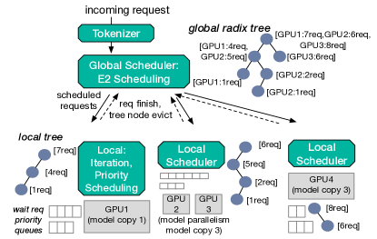

# LLM Application Deployment Project Brief

## Scenario

Northstar has prototyped a support assistant that answers operational questions.
The prototype works on a developer laptop but has no stable deployment contract,
no capacity evidence, and no way to connect answer-quality regressions to a
release or provider call. Your team must turn it into a deployment candidate.

## Main Goal

Build and evaluate an application that is reproducible, observable, and honest
about its operating limits. A reviewer should be able to deploy the container,
verify health and inference, inspect a request trace, reproduce evaluation
results, and decide whether the service meets its stated objectives.

## Required Implementation

### 1. API And Provider Boundary

Expose typed health, readiness, and generation routes. Keep provider code behind
an interface that tests can replace. Invalid input must fail before provider
usage, while upstream failures must produce an explicit service response.

### 2. Cache And Capacity Controls

Hash every output-affecting generation parameter in the cache key. Add a TTL,
bound concurrent provider calls, configure timeouts, and document whether the
cache is process-local or shared across instances.

### 3. Reproducible Deployment

Build a locked Python 3.13 image that runs as the same service locally and on
Render. Configure secrets outside the image, expose a lightweight health check,
and justify the selected instance count and scaling strategy.

*Source: Figure 6 from the scientific paper [Preble: Efficient Distributed Prompt Scheduling for LLM Serving](https://arxiv.org/abs/2407.00023). Use it as a discussion prompt for scheduling, queueing, and capacity decisions.*

### 4. LLM Observability

Record a root request observation plus nested cache, retrieval or preparation,
and generation stages. Include model, token usage, cost, latency, status,
environment, release, and a quality score. Define masking and sampling choices
for prompts and outputs.

### 5. Evaluation And Report

Run every shared case and the supplied load profile. Submit
`reports/deployment_report.md` with:

- deployment architecture and configuration;
- functional result and cache-hit evidence per case;
- throughput, p95 latency, and error rate;
- token, cost, and answer-quality summaries;
- one trace-based failure analysis;
- comparison with every service objective; and
- three prioritized changes before production approval.

## Suggested Milestones

### Milestone 1 - Reproducible Service

The API runs locally and in Docker, its tests mock external calls, and its
health/readiness contracts are distinct.

### Milestone 2 - Hosted And Observable

The Render service answers a live request, keeps credentials out of Git, and
exports a complete Langfuse observation tree with release metadata.

### Milestone 3 - Evidence-Based Decision

The shared evaluation and load probe are reproducible, and the report gives a
clear deploy, revise, or stop recommendation tied to measured evidence.

## Minimum Acceptance Checklist

- [ ] Python 3.13 dependencies resolve from `uv.lock`.
- [ ] API input and output contracts are typed and tested.
- [ ] Provider calls are asynchronous, bounded, and replaceable in tests.
- [ ] Repeated identical requests demonstrate a cache hit.
- [ ] Docker health checks pass locally.
- [ ] Render secrets are not committed.
- [ ] Observations include nested stages, usage, cost, release, and quality.
- [ ] All shared evaluation cases run without editing their labels.
- [ ] Load evidence is compared with all supplied objectives.
- [ ] The final report makes an explicit deployment recommendation.

## Submission Questions

1. Which failure should make readiness fail, and which should affect only one
   generation request?
2. How do cache-hit rate, duplicate provider calls and memory usage change when
   each service instance has its own process-local cache?
3. Which trace fields require masking or restricted retention?
4. What evidence distinguishes provider latency from application saturation?
5. Which measured result most strongly supports your final recommendation?
