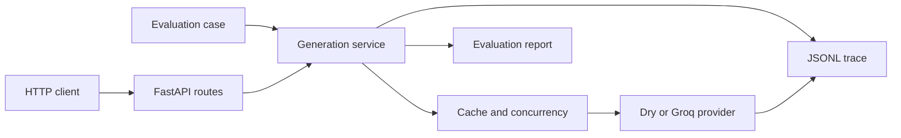

# Reference Solution

This folder contains a deterministic reference scaffold for the Northstar
deployment project. It separates provider calls, service controls, API routes,
evaluation, deployment configuration, and traces so each operational boundary
can be tested independently.

## Read The Solution In This Order

1. [models.py](deployment_project/models.py) defines the service contracts.
2. [provider.py](deployment_project/provider.py) supplies dry and Groq modes.
3. [service.py](deployment_project/service.py) adds cache and concurrency;
   [tracing.py](deployment_project/tracing.py) exports JSONL or Langfuse Python SDK v5
   observations with usage, release, and quality evidence.
4. [app.py](deployment_project/app.py) exposes the API.
5. [evaluation.py](deployment_project/evaluation.py) evaluates every shared
   case and renders the reference report.
6. [Dockerfile](Dockerfile) and [render.yaml](render.yaml) package and deploy
   the same application.



## Run The Reference Workflow

```bash
uv run python -m solution.deployment_project inspect-data
uv run python -m solution.deployment_project evaluate
uv run pytest solution/tests
uv run uvicorn solution.deployment_project.app:app --reload
```

Evaluation writes `reports/generated/evaluation.md` and
`solution/generated/evaluation_traces.jsonl`. It does not overwrite the
[checked-in example report](reports/reference_evaluation.md) or API traces.
It calls the service directly; route tests and a load probe test the HTTP layer.
Unit tests ignore `.env`, use the stub and keep their traces in temporary folders.

The reference defaults to dry mode. Set `MODEL_PROVIDER=groq` and provide
`GROQ_API_KEY` only when you intentionally want live provider calls.

The stub returns canned answers and word-count token estimates. The live provider
receives only the user prompt: it has no approved Northstar policy context.
Do not treat either path as a validated policy assistant.

The cache is process-local, limited to 1,024 entries and lost on restart.
Concurrent misses may duplicate calls. API usage describes the returned answer;
trace usage counts only new provider tokens. Failed calls report zero known
usage, which does not prove the provider charged nothing.

The evaluation checks expected words and cache behavior. The quality heuristic
can reward an incorrect answer containing those words; it is not a factuality score.
Evaluation always uses the local stub and JSONL, regardless of live-service settings.
Every repeated response is checked. Cache results are N/A for single-request
cases; mean latency includes both the initial miss and subsequent hits.

## Deployment Notes

The checked-in Blueprint uses one paid starter instance and requests secrets
from the Render dashboard. JSONL is the default trace sink so the full
evaluation runs without credentials; set `TRACE_SINK=langfuse` to use the
included Langfuse Python SDK v5 exporter (Cloud or self-hosted Langfuse 4.59.0+). Document prompt/output masking before live
traffic.

The exporter omits raw text, records failures and avoids generation observations
on cache hits. JSONL still stores demo prompts and answers locally.
Cloud observation durations measure export work, not original request stages;
use `request_latency_ms` metadata for the generation path, excluding trace export.
Measure end-to-end HTTP latency with the load probe. Add live nested
instrumentation, pricing and load evidence for the complete project requirements.
Telemetry failures are logged without turning successful generation into `502`.

From the repository root, test the container with:

```bash
docker build -f solution/Dockerfile -t northstar-deployment .
docker run --rm -p 127.0.0.1:8000:8000 northstar-deployment
```

The supplied API has no authentication or rate limiting. Keep local tests on
loopback; protect a public deployment before enabling paid model calls.
