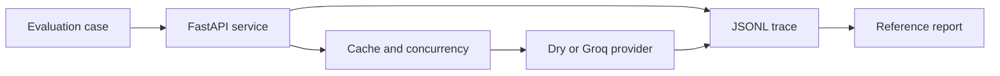

# Reference Solution

This folder contains a complete deterministic implementation of the Northstar
deployment project. It separates provider calls, service controls, API routes,
evaluation, deployment configuration, and traces so each operational boundary
can be tested independently.

## Read The Solution In This Order

1. [models.py](deployment_project/models.py) defines the service contracts.
2. [provider.py](deployment_project/provider.py) supplies dry and Groq modes.
3. [service.py](deployment_project/service.py) adds cache and concurrency;
   [tracing.py](deployment_project/tracing.py) exports JSONL or Langfuse v4
   observations with usage, release, and quality evidence.
4. [app.py](deployment_project/app.py) exposes the API.
5. [evaluation.py](deployment_project/evaluation.py) evaluates every shared
   case and renders the reference report.
6. [Dockerfile](Dockerfile) and [render.yaml](render.yaml) package and deploy
   the same application.



## Run The Reference Workflow

```bash
uv run python -m solution.deployment_project inspect-data
uv run python -m solution.deployment_project evaluate
uv run pytest solution/tests
uv run uvicorn solution.deployment_project.app:app --reload
```

The reference defaults to dry mode. Set `MODEL_PROVIDER=groq` and provide
`GROQ_API_KEY` only when you intentionally want live provider calls.

## Deployment Notes

The checked-in Blueprint uses one paid starter instance and requests secrets
from the Render dashboard. JSONL is the default trace sink so the full
evaluation runs without credentials; set `TRACE_SINK=langfuse` to use the
included Langfuse v4 exporter. Document prompt/output masking before live
traffic.
